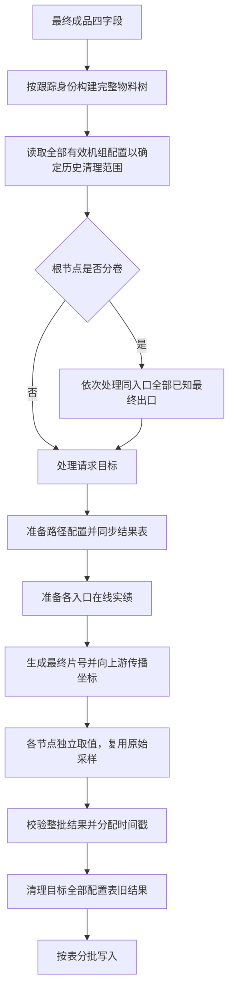

# 跨工序切片接口

## 接口路径

`POST /api/quality/piece/overcell-output`，以最终成品为目标，向上游追溯并生成各加工单元的切片。

## 入参

| 参数 | 类型 | 必填 | 说明 |
| --- | --- | --- | --- |
| unitCode | String | 是 | 最终机组代码，去首尾空白并转大写 |
| outMatNo | String | 是 | 最终出口物料号，原值保留 |
| outMatRepeatProdNo | String | 是 | 最终出口重复生产次数，字符串，保留前导零 |
| cellCode | String | 是 | 最终加工单元代码，关系查询按原值匹配 |

```json
{"unitCode":"CSL1","outMatNo":"FINAL001","outMatRepeatProdNo":"01","cellCode":"CSL1001"}
```

对外入参与单工序相同，不传库表、跟踪号、上游片长或开卷卷取方式。最终节点必须属于可产出切片的加工单元。

## 数字钢卷跨工序切片流程



### 1. 跨工序物料跟踪树构建

`OCPieceTreeServiceImpl.build` 在单次 PostgreSQL REPEATABLE_READ 只读事务中建树。

- 根节点按请求四字段查询完整关系，正常/并卷/分卷的关系补齐与校验复用 PieceBaseDataReader。
- 当前入口的 in_mat_track_no + in_mat_prod_no 匹配候选上游的 out_mat_track_no + out_mat_prod_no；不使用物料号或重复生产次数替代。
- 根据 OCPieceCellProfile.traceOrder 选出小于当前顺序的最近前序单元；候选加工单元必须已登记。相同最近顺序存在多机组、加工单元或出口歧义时失败，不取任意第一条。
- 并卷遍历全部入口，分卷保留全部兄弟关系，但节点出口身份仍是所追溯的目标出口。
- 入口跟踪号及跟踪次数可同时缺失并结束该入口追溯；只缺一项非法。无符合条件上游时正常终止分支；并卷坐标分配另要求所有入口上游实长完整。
- 相同物料不能映射到矛盾跟踪身份，不同物料不能共用同一跟踪身份。按当前路径的机组、加工单元、出口跟踪身份检查循环；汇聚上游在不同路径生成独立节点。

### 2. 跨工序基础数据构建

`OCPieceBaseDataServiceImpl.prepare` 层序遍历所有节点，为产片单元按机组去重读取配置和数字参数。

每个参与产片的机组恰一条有效配置，piece_ts_database、oc_piece_ts_table 必填；不要求单工序 piece_ts_table。只有最终机组必须配置正 piece_length，上游片长由坐标传播决定。参数筛选和字段冲突校验复用共用读取器。

YL001 原料入库、BAF1001 罩式炉保留在树中，但不准备切片配置、不读在线实绩、不写结果；罩式炉的上游仍继续遍历。最终节点不可是这两种仅追溯单元。

`OCPieceStoreService.sync` 同步本次路径涉及结果表，先验证跨工序与全部有效单工序表无交叉，同一路径不同机组不共用跨工序表。表名来自配置。

### 3. 在线数据填充

`OCPieceOnlineMatDataServiceImpl.prepare` 在独立 PostgreSQL 只读快照中为产片节点逐入口读取：

- 合并生产时间及前后各 1h 查询窗，缺开始时间逐行按结束前 2h 兜底。
- 同批全部设备剪切记录生成两套数据：trHead/trTail/trSlice 用于节点内取值，head/tail/slice 用于跨节点映射。
- 跨工序分切以设备代码 + shear_no 为组键，按首刀时间排序；卷取机组截断/补零到 n−1 项，全部设备组只补零、保留额外组。额外组无法与出口缝一一对应时，坐标阶段会拒绝非空片映射。
- 最新开卷卷取实绩缺字段时按单元默认值补齐，非法非空编码仍报错，不覆盖有效实绩。
- 最新切边实绩的 trimming_length 按十进制文本解析为非负毫米值，无记录为 0；存在但空白/非数字/负数则失败。

先准备所有节点到临时集合，全部成功后整体填充树，避免半棵树处于已填状态。数据结构详见[关键数据结构](跨工序切片关键数据结构.md)。

### 4. 切片元数据填充

最终成品先以最终机组配置片长生成完整片，方向 false/false、两侧累计切边为 0。随后层序向前传播：

- 片号始终沿用最终成品，不对上游重新编号；每片边界改为当前成品带头起算的米制坐标。
- 成品→入口使用全部设备剪切及上游成品实长，正常/分卷/并卷分别恢复偏移和缩放。
- 并卷按上游入口保留长度比例反向划分，接缝落入片内时对齐片尾；原料入口占据贡献区间但不接收切片元数据。
- 开卷和卷取共同决定累计上下、操作侧传动侧方向；切边先由成品侧转在线侧，加本单元单侧切边，再转入口侧。
- 罩式炉只允许一进一出正常关系，元数据原样穿透，不做剪切、缩放或方向变化。

全部坐标计算成功后才统一赋值。公式和方向组合见[跨工序映射](数字钢卷切片计算过程中的数据映射关系.md)。

### 5. 基于当前节点片段取值

`OCPieceQueryDataServiceImpl.query` 切换 TDengine slave1，复用单工序 PieceLengthCalculator.convertMapped、PieceAverageCalculator 和 PieceSampleReader。

段内映射使用 tr 系列剪切、各工艺表自己的 MAX(head_length)，不使用全部设备剪切；片号允许稀疏、局部坐标允许反向排列。工艺为双闭均值，空字段按同入口同表限距插值（两侧各 ≤2m、总间距 ≤3m），仍无值为 NULL。

任一入口在线长度无效，整段参数 NULL，该段不参与片号筛选；所有段均无效则该节点失败。有效工艺段和有表检来源的覆盖片号取集合交集，不能按最短结果条数截取稀疏片号。

CP1/FCL1 读取表检，按其独立在线长度调用 convertMapped。与单工序不同，跨工序并卷表检不固定首个工艺段的入口贡献边界。表检全部无记录返回 []、不限制片号；部分并卷入口缺记录则该节点失败。有表检时由表检映射确定方向所属入口，否则用首个有效工艺来源。

同请求按机组、加工单元、入口、生产窗、库表缓存原始采样及缺陷索引；不同路径分别计算坐标，不缓存已经换算过的位置。缺陷内容与方向详见[存储细则](数字钢卷跨工序切片表存储细则.md)。

### 6. 校验、历史清理与写入

先将成功结果按库表分组，验证身份容量、片号、区间、参数键、数值有限性和缺陷 JSON 容量，分配各表毫秒时间段，再按最终物料号及重复次数清理全部已配置跨工序表中的旧结果，全部清理成功后才开始写入。

清理包含当前路径外的历史机组结果，但仅能覆盖当前有效配置仍指向的表；已移除配置的旧表不会被自动发现。空节点结果也可触发清理。默认每表每次 HTTP 最多 1000 行，由 overcell-http-batch-size 控制。

## 分卷整组重算

仅根节点 mat_type=2 时，将同入口全部已知出口按业务顺序逐卷处理。请求根树可复用，其他最终卷独立重建树、读取配置和实绩，不共享可变元数据；不保证整组同一快照。上游节点存在分卷不会触发兄弟最终卷展开。

逐最终卷捕获建树、准备、查询和保存异常，继续其他卷，整组结束统一抛错；成功卷不回滚，重试仍重算全部已知最终卷。初次根树构建失败则无法展开整组。

## 返回值与失败边界

成功响应 `ResultBean<Integer>`：`{"success":true,"msg":"操作成功","data":120}`。data 是请求最终卷在全部成功节点实际保存的总行数，不是最终片数，也不包含兄弟最终卷行数。

| 失败位置 | 当前行为 |
| --- | --- |
| 建树、配置、表同步、在线准备、坐标阶段 | 该最终卷失败，不开始结果替换；表同步产生的结构变更不回滚 |
| 某节点工艺/表检取值失败 | 记日志并跳过节点，上游继续取值 |
| 全部产片节点取值均失败 | 抛出首个失败，避免空结果清理旧数据 |
| 至少一个节点取值成功 | 可成功返回并替换；失败节点旧结果同样会被全表目标清理，不保留旧行 |
| 清理中途失败 | 停止写入，已清理部分不回滚 |
| 写入中途失败 | 可能只留下部分新结果，重新请求整卷恢复 |

HTTP 400/500 与 ResultBean 错误格式沿用 PieceOutputController；查询包装异常通常进入 500。成功返回没有逐节点失败清单，完整性需结合日志、预期路径及落库片号检查。

## 跨工序独立删除

`POST /api/quality/piece/overcell-delete`：

```json
{"outMatNo":"FINAL001","outMatRepeatProdNo":"01"}
```

仅两个必填字符串，分别匹配 final_mat_no、final_mat_repeat_prod_no，最多各 50 UTF-8 字节。服务端读取全部有效机组配置确定清理表，不建树、不依赖原料关系或在线实绩、不联动兄弟最终卷。没有任何跨工序表配置时拒绝；不存在的表跳过，无匹配行也成功。成功信封 data 允许为 null。

没有公开跨工序身份修改、跨工序时间范围查询或追溯树查询接口；不能把内部 Java 服务名当成 HTTP 接口。

## 实现依据

`PieceOutputController`、`OCPieceOutputServiceImpl`、`OCPieceTreeServiceImpl`、`OCPieceBaseDataServiceImpl`、`OCPieceOnlineMatDataServiceImpl`、`OCPieceMetaDataServiceImpl`、`OCPieceQueryDataServiceImpl`、`OCPieceStoreService`、`OCPieceManageService`。对应测试覆盖正常链路、分卷联动、汇聚路径、稀疏片号、部分节点失败等；本次未执行测试。
